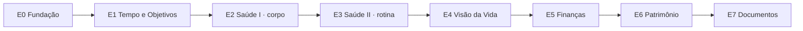

# Lume — Decisões e Roadmap

> Registro vivo do contexto do projeto: o que o Lume é, as decisões já tomadas (e por quê) e o roadmap de entregas.
> Atualize este arquivo sempre que uma decisão nova for tomada ou uma entrega avançar.
>
> **Última atualização:** 2026-11-11 · **Branch:** `new-plan/mudanca_de_escopo`
> **Jira:** projeto [LUME](https://felipeoliveiranogueira.atlassian.net/jira/software/projects/LUME) (ver seção 7)

---

## 1. Visão do produto

O Lume começou como um organizador visual de rotina e objetivos (um "quadro de horários" vivo, aberto o dia todo num tablet ou monitor). Em **2026-09-28** o escopo mudou:

> O Lume passa a ser um **ERP pessoal**: um gerenciador de uma vida, assim como um ERP gerencia o ecossistema de uma empresa.

Princípios que guiam todas as decisões:

- **Tirar o ruído mental.** Agrupar todas as informações da vida da pessoa para que tudo fique visível, tangível e manipulável.
- **Frentes conectadas.** Sono, alimentação, peso/IMC, trabalho, objetivos, finanças e prazeres parecem desconexos, mas se influenciam. O app deve mostrar essas ligações.
- **Caminho do meio.** Ajudar a pessoa a sair dos extremos (conforto demais ou pressão extrema).
- **Pró-humano.** O oposto de redes sociais e apps de apostas: nada de gatilhos de vício, impulso, comparação ou punição.
- **Profissional.** Visual impecável, paleta com contraste forte, layout limpo.

---

## 2. Histórico do projeto (antes da mudança de escopo)

App React (na raiz do repositório), mantido hoje **apenas como referência** de funcionalidades.

| Versão | Entregas |
|---|---|
| MVP 0.0.1 | Painel ambiente, grade semanal e objetivos |
| MVP 0.0.2 (PR #1) | Modelo v2 (prioridade, fila, stats, conquistas, premiações), Home em cards, Modo Foco, assistente de objetivos, escala global |
| MVP 0.0.3 (PR #2) | Domínio v3 (trabalho, foco manual, fechamento do dia, rotina) · server Express + MongoDB, login JWT por tenant e sync local-first |
| MVP 0.0.4 | Splash com fogo e explosão em canvas (branch `mvp/mvp-0.0.4`, não mesclada na `main`) |

Stack do app React: React 19, Vite, TypeScript, Zustand, Tailwind v4, PWA, Vitest · Express + MongoDB.

Diagnóstico feito na mudança de escopo:

- O **domínio** (`src/domain/`) é a parte mais valiosa: testado e independente de tela. Suas regras devem ser portadas.
- As **telas** eram muito acopladas ao visual antigo (ex.: `FocoView.tsx` com ~1.000 linhas) e serão refeitas.
- O **sync** guarda o estado inteiro num único documento (`server/src/models/StateDoc.ts`), e em conflito a versão do servidor sobrescreve tudo (`src/store/sync.ts`). Não escala para vários módulos.

---

## 3. Decisões tomadas

### D1 — Stack: seguir as diretrizes à risca (2026-09-28)
- **Frontend:** Flutter/Dart com Clean Architecture (`app/`).
- **Backend:** Quarkus (Java) com arquitetura hexagonal e MapStruct. *Ainda não iniciado.*
- **Banco:** PostgreSQL com Flyway, auditoria, soft delete, optimistic locking e UUIDs públicos. *Ainda não iniciado.*
- **Consequência:** reescrita total. O domínio React será portado para Dart/Java; o app React fica só como referência.
- Alternativas descartadas: manter React e trocar só o backend; manter tudo como estava (React + Express + Mongo).

### D2 — Temas claro e escuro desde a fundação (2026-09-28)
- Tokens de cor únicos por tema (`app/lib/core/theme/app_colors.dart`), para nunca precisar refazer telas.
- Hoje o app abre no **tema escuro**. O **tema claro está provisório** até chegar a referência visual dele.

### D3 — Gamificação reformulada, sem mecânicas de vício (2026-09-28)
- A "sequência que quebra" (chama/streak) vira **consistência** (ex.: 5 de 7 dias), sem punição e sem comparação.
- Prêmios viram **recompensas conscientes**, ligadas ao equilíbrio.
- Mensagens gentis quando o ritmo cai (ex.: "Constância vale mais que intensidade").

### D4 — Roadmap por entregas, sem datas (2026-09-28)
Ordem aprovada: E0 → E1 → E2 → E3 → E4 → E5 → E6 → E7 (detalhes na seção 5).

### D5 — Construção tela por tela, em conjunto (2026-09-28)
- Cada tela nasce só com o fundo e é implementada junto com o usuário, passo a passo.
- Os designs externos (UI kit "Eclipse", do Figma) são **guias visuais**, não cópias: a composição é adaptada à necessidade do Lume.

### D6 — Composição do dashboard (Visão geral) (2026-09-28)
- **Card "Agora":** atividade atual, horário, tempo restante com barra, próxima atividade. Estados: em atividade, tempo livre, dia concluído, sem rotina. Atualiza a cada 30s.
- **Seu dia:** saudação + data e três anéis: blocos de hoje, dias na semana (consistência) e etapas dos objetivos.
- **Próximas atividades** e **objetivos ativos** (com a cor do objetivo).
- **Ritmo da semana:** horas dedicadas nos últimos 14 dias, hoje em destaque.
- **Frentes da vida:** módulos que ainda não existem aparecem como **cards "Em breve · Ex"** (a estrutura do ERP já fica visível).
- Por enquanto usa **dados de exemplo** (`dashboard_mock_datasource.dart`).

### D7 — Dashboard financeiro guardado para a E5 (2026-09-28)
- A primeira tela feita a partir do Eclipse (cartão de crédito, gastos, transações, recorrentes) foi movida para `app/lib/features/finance/` como base do módulo Finanças. Fica fora da navegação até a E5.

### D8 — Menu de Módulos (2026-09-28)
- Botão **Módulos** abre um painel suspenso ancorado no botão, com cantos arredondados, sombra e animação (fade + escala, 220ms para abrir e 160ms para fechar).
- Conteúdo em **grade de cards**: Visão geral, Tempo e objetivos, Saúde, Finanças, Patrimônio, Documentos. O módulo aberto fica destacado; os futuros mostram "Em breve · Ex" e não navegam.
- Fecha ao tocar fora ou com Esc. Rotas inválidas voltam para a Visão geral.
- Navegação com `go_router`. Catálogo único de módulos em `app/lib/core/modules/`: quando um módulo ganha tela, o menu e o dashboard mudam juntos.
- **Tempo e objetivos** (`/tempo`) já tem rota e tela, por enquanto só com o fundo.

### D9 — Paleta de cores (2026-09-28) · ⚠️ a ser substituída pela D12
> Esta é a paleta **atualmente no código**. Ela será trocada quando a tarefa LUME-68 (tokens de cor v2) for implementada.

- Testado e **revertido**: paleta preto/vermelho e depois uma paleta "agressiva" (carmim, brasa, âmbar). O usuário preferiu a original.
- **Paleta vigente:** acentos violeta `#5B16F0`, ciano `#16D4F5` e laranja `#FF8A00` (`app_palette.dart`), logo azul → roxo, cores de objetivos variadas para serem reconhecíveis.
- **Card "Agora":** gradiente **deep navy**, de `#060B1A` a `#1C3C86`, com texto branco e brilho azul discreto.
- Fundos escuros mantidos: `#050506` (fundo), `#0C0C0F` (superfície), `#17171B` (superfície elevada).
- Tipografia: **Inter** (fontes locais em `app/assets/fonts/`).

### D10 — Splash de abertura removido (2026-09-28)
- A animação de fogo/explosão foi considerada estranha e pouco profissional. O app Flutter não tem splash: ele fica aberto o dia todo e uma abertura elaborada não acrescenta nada.

### D11 — Ambiente de desenvolvimento com auto reload (2026-09-28)
- `app/tool/dev_server.mjs` sobe o Flutter web em `http://localhost:5500`, vigia `lib/` e `assets/` e recompila sozinho. Se o Flutter cair, ele reinicia em ~1,5s.
- Uso: `cd app && node tool/dev_server.mjs`. Mudanças no `pubspec.yaml` exigem reiniciar o servidor.

### D12 — Design System v2 "brasa" (2026-11-09) · 🟡 decidido, implementação não iniciada
- O visual do app será refeito com o **Design System v2 "brasa"**, publicado como artefato (https://claude.ai/artifact/9TAdTj4LkKjQRPiaVbH9XK, versão 4), com brand book, regras de movimento, responsividade, tradução para widgets Flutter e tokens.
- Épico no Jira: **LUME-67 · E0.1** (a fundação visual). As telas de Tempo e objetivos e o Modo Foco redesenhados ficam na E1 e dependem deste épico.
- **Linguagem visual:**
  - Uma fonte de luz por tela (brilho + respiração de 6s), só no elemento que está acontecendo agora.
  - Superfícies em camadas: `surface` com linha fina no topo e sombras em duas camadas (`elev-1/2/3`). Sem `Card` do Material.
  - Aurora de fundo (dois gradientes radiais), uma vez por página, no scaffold.
  - Vidro (`surface-glass` + blur 20) só em elementos flutuantes: BottomNav, Sheet, menu de módulos e Toast.
  - Raios concêntricos 16 → 12 → 8 → 4.
  - Progresso que "acende": barra ou anel com cabeça luminosa laranja → brasa, e passos concluídos que esfriam para violeta.
  - Movimento: `ease-out` para entrar, `ease-in` (mais curto) para sair, mola só ao soltar botão, marcar check ou trocar de passo. `disableAnimations` é respeitado em tudo.
- **Navegação responsiva** em três classes de tela: compact, medium e wide, com BottomNav em vidro no celular.
- **Pronto quando:** o dashboard atual renderiza com a v2 nos dois temas e nas três classes de tela, com goldens e teste de contraste passando.
- **Efeito sobre decisões anteriores:** a D9 (paleta) será substituída; a D2 (tema claro e escuro) continua valendo, e o tema claro definitivo agora faz parte deste trabalho (LUME-23).
- **Novo modelo de domínio de Tempo** (LUME-82): Atividade (cotidiana ou de objetivo), Passo com estimativa, Anotação e consistência. O Modo Foco v2 vira "foco absoluto" (LUME-84), com encerramento próprio (LUME-85).

### Restrições de produto já definidas
- **Dados de saúde são sensíveis (LGPD, art. 11):** exigem criptografia, consentimento explícito e trilha de auditoria.
- **O app registra doses, nunca recomenda dose.** Vale para canetas (Mounjaro/tirzepatida) e qualquer medicamento.
- **Documentos exigem armazenamento dedicado e criptografado**, nunca dentro do estado da aplicação.
- **Sync por módulo ou por registro**, nunca por documento único como no app React.

---

## 4. Estado atual do app Flutter (`app/`)

```
app/lib/
├── app/          # LumeApp, navegação (go_router, menu de módulos) e shell (top bar, footer, scaffold)
├── core/         # constants (breakpoints), modules (catálogo), theme (cores, paleta), utils, widgets
└── features/
    ├── dashboard/  # Visão geral — domain (entidades), data (mock), presentation (layouts compacto e largo)
    ├── finance/    # Guardado para a E5 — domain, data (mock), presentation
    └── time/       # Tempo e objetivos — só a página, com fundo
```

- Dependências: `go_router`, `intl`. Versão `0.1.0`.
- Qualidade: `flutter analyze` limpo e **110 testes** passando, cobrindo limites de horário da agenda (início incluso, fim excluso), meia-noite, os quatro estados do card "Agora", estados vazios, seis tamanhos de tela (de 320px a desktop) nos dois temas e fonte ampliada (1,3×).

---

## 5. Roadmap

Entregas completas, sem datas. Cada uma só começa quando a anterior cumpre o critério de "pronto".



| # | Entrega | Escopo | Pronto quando | Status |
|---|---|---|---|---|
| **E0** | Fundação | Design system (paleta, tipografia, componentes), estrutura do ERP (navegação e registro de módulos), backend definitivo (Quarkus + PostgreSQL), sync por módulo, remoção do splash | Um módulo "vazio" funciona de ponta a ponta na estrutura nova | 🟡 Em andamento: design system v1, dashboard, menu de módulos, catálogo e remoção do splash prontos · backend e sync não iniciados · **E0.1** (DS v2 "brasa", LUME-67) planejado antes da E1 |
| **E1** | Tempo e Objetivos | Painel, Grade, Objetivos, Foco e Mês nas telas novas, portando o domínio do app React | Tudo o que o app React faz funciona no visual novo | ⏭️ Próxima, depende da E0.1: tela `/tempo` criada só com fundo; tarefas e histórias no Jira (LUME-2) |
| **E2** | Saúde I — corpo | Peso, IMC, medidas, caneta (aplicações, dose, evolução de dose, local da aplicação, lembrete) | Dá para acompanhar um tratamento com tirzepatida do começo ao fim | ⬜ |
| **E3** | Saúde II — rotina | Alimentação e sono | Sono e alimentação aparecem cruzados com o peso | ⬜ |
| **E4** | Visão da Vida | Visão geral de todos os módulos, equilíbrio entre as áreas, evolução comparativa | A tela inicial mostra o "caminho do meio" com dados reais | ⬜ |
| **E5** | Finanças | Contas, categorias, fluxo do mês (base visual já existe em `features/finance`) | Contas, categorias e fluxo do mês funcionando | ⬜ |
| **E6** | Patrimônio | Imóveis, veículos (manutenção, IPVA, seguro) e casa | Vencimentos e manutenções com alertas | ⬜ |
| **E7** | Documentos | Upload com armazenamento criptografado, consulta, vencimentos | Faço upload, consulto e sei quando cada documento vence | ⬜ |

A Visão da Vida (E4) vem depois de Saúde de propósito: sem dados de pelo menos dois módulos, não há o que comparar.

---

## 6. Melhorias e pendências já levantadas

### Próximos passos imediatos
- [ ] **E0.1 · Design System v2 "brasa" (LUME-67):** tokens de cor (LUME-68), espaçamentos, raios e sombras (LUME-70), `AppPageScaffold` v2 (LUME-72), kit de widgets base (LUME-73), estados padrão (LUME-76), BottomNav em vidro (LUME-75), dashboard v2 (LUME-77), goldens e contraste (LUME-78) e acessibilidade (LUME-79).
- [ ] **Tela Tempo e objetivos (E1):** levantar o que o app React faz em Tarefas, Rotina e Objetivos e montar a proposta de tela, como foi feito com o dashboard (LUME-57). Depois, o modelo de domínio (LUME-82) e as telas v2 (LUME-80, 81, 83, 84, 85).
- [ ] **Ligar o dashboard a dados reais**, substituindo o `dashboard_mock_datasource.dart`, junto com a E1 (LUME-64).
- [ ] **Tema claro definitivo (LUME-23):** agora faz parte do DS v2; antes aguardava a imagem de referência do frame `868-27423` do Eclipse.

### Decisões aguardando aprovação
- [ ] **Exceção à regra "um arquivo por classe"** para pares `StatefulWidget`/`State` (ex.: `now_builder.dart`, `LumeApp`). É o padrão do Flutter; separar obrigaria a deixar o `State` público.

### Fundação técnica (E0)
- [ ] Criar o backend Quarkus (hexagonal + MapStruct) e o PostgreSQL com Flyway. No ambiente de desenvolvimento há Java 25, Maven e Docker; o `psql` não está instalado (usar PostgreSQL via Docker).
- [ ] Desenhar o sync por módulo/registro, com resolução de conflito que não descarte mudanças de outros módulos.
- [ ] Definir criptografia, consentimento e auditoria para dados de saúde antes da E2.

### Legado (app React na raiz)
- [ ] O `README.md` da raiz está desatualizado: descreve só o app React e diz "sem sync entre dispositivos", mas login e sync já existem. Atualizar para refletir o novo escopo e o app Flutter.
- [ ] O `npm install` do frontend React apontou 5 vulnerabilidades (3 altas).
- [ ] Não existe `server/.env`; para rodar o server contra o MongoDB Atlas é preciso `MONGODB_URI` e `JWT_SECRET` (ver `server/.env.example`). Para testes locais existe `npm run dev:memory`.
- [ ] Decidir quando o app React será aposentado (após a E1 cobrir todas as suas funcionalidades).

### Design
- [ ] (LUME-27) Ícones e imagens do Eclipse foram substituídos por equivalentes (chip e logo Mastercard em código, ícones Material), porque o arquivo do Figma não permite leitura sem acesso de edição. Duplicar o arquivo para a própria conta libera a extração exata de tokens e ícones.

---

## 7. Jira

Projeto **LUME** em `felipeoliveiranogueira.atlassian.net`, criado em 2026-11-09 a partir deste roadmap. Os épicos espelham as entregas:

| Épico | Entrega |
|---|---|
| LUME-1 | E0 · Fundação |
| LUME-67 | E0.1 · Design System v2 "brasa" (D12) |
| LUME-2 | E1 · Tempo e Objetivos |
| LUME-3 | E2 · Saúde I — corpo |
| LUME-4 | E3 · Saúde II — rotina |
| LUME-5 | E4 · Visão da Vida |
| LUME-6 | E5 · Finanças |
| LUME-7 | E6 · Patrimônio |
| LUME-8 | E7 · Documentos |

- O Jira guarda o detalhamento em tarefas e histórias; este arquivo guarda o **porquê** das decisões.
- Itens já entregues antes da criação do projeto (design system v1, dashboard, menu de módulos) não têm ticket.
- **Concluído no Jira:** LUME-19 (remover o splash do app), em 2026-11-11.
